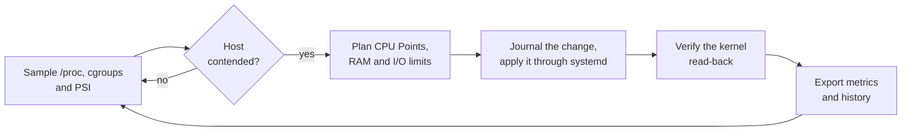

# ResMan

**Fair CPU, memory and I/O sharing for multi-user Linux hosts, enforced through
systemd and only when the host actually needs it.**

[](https://github.com/fdefilippo/resman/actions/workflows/ci.yml)
[](https://github.com/fdefilippo/resman/releases/latest)
[](LICENSE)

ResMan is a daemon for shared Linux machines such as login and bastion hosts,
compute nodes, build servers and teaching labs, where one user's runaway job can
starve everyone else. It watches per-user CPU, memory and block-I/O usage. It steps
in only when the host is genuinely contended, gives every user a predictable share
through their own systemd slice, and steps back once the pressure is gone. Each
decision is measured, verified in the kernel and exported.

## Why ResMan

- **Fair by contract.** CPU Points divide the host into 1000 points. A reserve stays
  outside `user.slice` for `system.slice`, root and every mapped user receive a
  relative entitlement, and anyone may borrow capacity nobody else is using.
- **Quiet until it matters.** CPU limits activate only after eligible users keep a
  configurable share of the host busy for a configurable time, and they are released
  after a measured cool-down. Optional PSI events wake the control loop as soon as
  the kernel reports real stall.
- **Native to systemd.** ResMan sets properties on the users' own systemd slices
  without moving processes or building a cgroup tree of its own, so sessions,
  services and rootless containers keep their structure. Without an authoritative
  systemd adapter it runs in `observation_only` and enforces nothing.
- **Safe across crashes.** Every systemd property ResMan changes is recorded in a
  write-ahead journal first. After a crash it finishes or reverts exactly what it
  recorded, and a change it cannot prove it owns is left in place and reported.
- **Honest memory and I/O limits.** RAM and hard I/O limits are applied only when the
  whole workload of a UID sits under its slice. Otherwise ResMan reports why it
  refused instead of claiming coverage it does not have.
- **Observable end to end.** Prometheus metrics, a Grafana dashboard, SQLite history
  and kernel read-back show what was configured, what was applied and what was
  delivered.
- **Built for operations.** Hot-reloaded configuration, include and exclude filters,
  blackout windows, script and webhook notifications, RPM and DEB packages, and an
  [MCP server](docs/MCP-README.md#discovery-inventories) for AI assistants.

## How it works



When CPU-eligible users cross the threshold, ResMan programs a finite CPU envelope
on `user.slice` and relative weights on every `user-UID.slice` through systemd's
D-Bus API. Root has its own `CPU_ROOT_POINTS` entitlement. Every value is confirmed
in the kernel before it counts as applied. When usage stays below the release
threshold, every slice returns to its recorded baseline. The result is a relative
share of delivered bandwidth, not cpuset isolation: weight and class changes take
effect in place, without moving processes. The
[architecture overview](docs/ARCHITECTURE.md) and the
[CPU Points observability guide](docs/CPU-POINTS-OBSERVABILITY.md) describe the
model in depth.

ResMan complements
[`systemd-oomd`](https://www.freedesktop.org/software/systemd/man/systemd-oomd.service.html):
`systemd-oomd` is the emergency response to severe memory pressure, while ResMan
governs ordinary contention and never chooses what to kill
([how they fit together](docs/ARCHITECTURE.md#relationship-with-systemd-oomd)).

## Quick start

Download the RPM for Enterprise Linux 8, 9 or 10, or the Debian/Ubuntu package, from
the [latest release](https://github.com/fdefilippo/resman/releases/latest) and
install it:

```bash
sudo dnf install ./resman-*.rpm      # or: sudo apt install ./resman_*.deb
```

The package does not start the service. Make users eligible and, optionally, give
some of them a larger share:

```bash
# /etc/resman/resman.conf
USER_INCLUDE_LIST=.*          # every non-excluded user may be limited
CPU_THRESHOLD=75              # act when eligible users keep 75% of the host busy
CPU_THRESHOLD_DURATION=90     # ...for 90 seconds
ENABLE_PROMETHEUS=true        # metrics on localhost:1974
```

```ini
# /etc/resman/cpu-points.map
[resman-cpu-points-map-v1]
alice=300
john.smith=200
```

Then start ResMan and watch it work:

```bash
sudo systemctl enable --now resman
journalctl -u resman -f
curl -s http://localhost:1974/metrics | grep '^resman_'
```

Upgrading from an earlier release? Read the [upgrade guide](docs/UPGRADING.md) before
installing: it lists every breaking change since 1.25.x and the action each one
requires.

## Requirements

- Linux 4.18 or later with the unified cgroup v2 hierarchy and systemd, including the
  systemd 239 of Enterprise Linux 8
- Root privileges for the service
- Optional: Pressure Stall Information for event-driven cycles, Prometheus and Grafana
- To build from source: Go 1.27.1+ with CGO enabled for NSS, LDAP and SSSD username
  resolution

Build, packaging and host preparation are covered in the
[installation guide](docs/INSTALLATION.md).

## Documentation

| Topic | Where |
|---|---|
| Build, install and host preparation | [`docs/INSTALLATION.md`](docs/INSTALLATION.md) |
| Every configuration key, default and reload rule | [`docs/CONFIGURATION.md`](docs/CONFIGURATION.md), `config/resman.conf.example` |
| Upgrading from 1.25.x or later | [`docs/UPGRADING.md`](docs/UPGRADING.md) |
| Operator reference | `man resman` |
| Architecture and control flow | [`docs/ARCHITECTURE.md`](docs/ARCHITECTURE.md), [`docs/TECHNICAL-SPECIFICATION.md`](docs/TECHNICAL-SPECIFICATION.md) |
| CPU Points accounting and measurements | [`docs/CPU-POINTS-OBSERVABILITY.md`](docs/CPU-POINTS-OBSERVABILITY.md) |
| Memory and I/O limits, weighted I/O | [`docs/IO-LIMITS.md`](docs/IO-LIMITS.md), [`docs/IO-WEIGHTS.md`](docs/IO-WEIGHTS.md), [`docs/WIKI-MEMORY-HIGH.md`](docs/WIKI-MEMORY-HIGH.md) |
| Crash-safe systemd changes | [`docs/SYSTEMD-PROPERTY-LEASES.md`](docs/SYSTEMD-PROPERTY-LEASES.md) |
| Cgroup v2 capability contract | [`docs/CGROUP-V2-TECHNICAL.md`](docs/CGROUP-V2-TECHNICAL.md) |
| Metrics history database | [`docs/METRICS-DATABASE.md`](docs/METRICS-DATABASE.md) |
| Prometheus, Grafana and alerts | [`docs/GRAFANA-DASHBOARD-GUIDE.md`](docs/GRAFANA-DASHBOARD-GUIDE.md), [`docs/prometheus-queries.md`](docs/prometheus-queries.md), [`docs/alerting-rules.yml`](docs/alerting-rules.yml) |
| Monitoring many hosts | [`docs/MULTI-INSTANCE-MONITORING.md`](docs/MULTI-INSTANCE-MONITORING.md), [`docs/GRAFANA-MULTI-CLUSTER-GUIDE.md`](docs/GRAFANA-MULTI-CLUSTER-GUIDE.md) |
| TLS for the Prometheus endpoint | [`docs/TLS-CONFIGURATION.md`](docs/TLS-CONFIGURATION.md) |
| Limit notifications | [`docs/LIMIT-HOOKS.md`](docs/LIMIT-HOOKS.md) |
| MCP server, transports and TLS | [`docs/MCP-README.md`](docs/MCP-README.md) |
| LDAP and NIS usernames | [`docs/LDAP-USERNAME-RESOLUTION.md`](docs/LDAP-USERNAME-RESOLUTION.md) |
| Rootful Podman deployment | [`docs/CONTAINER.md`](docs/CONTAINER.md) |

## Contributing

Read [`CONTRIBUTING.md`](CONTRIBUTING.md) and the normative
[development guide](docs/DEVELOPMENT.md) before changing code.

## License

GNU General Public License v3.0. See [LICENSE](LICENSE).
